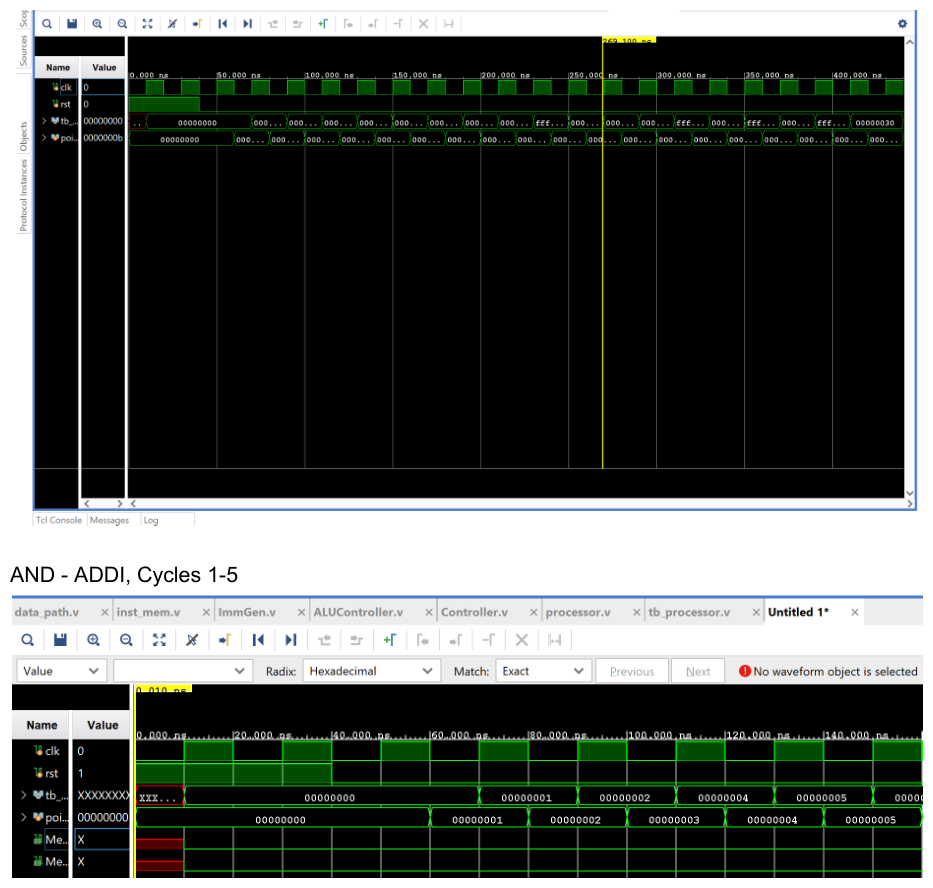
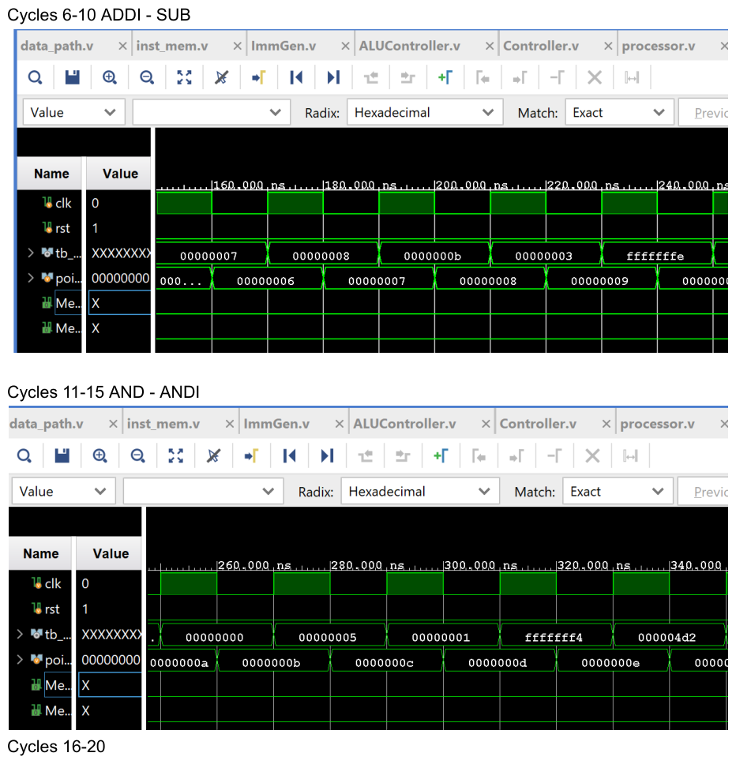
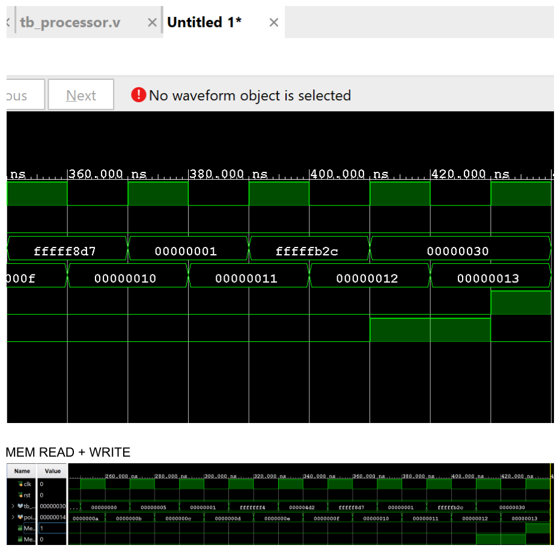

# RV32I Single-Cycle Processor

> A single-cycle RISC-V processor core implementing the RV32I integer subset (register, immediate, load, and store instructions) in Verilog, verified with directed instruction-stream simulation in Vivado — being extended into a hazard-resolved, coverage-verified 5-stage pipeline.


---

## Overview

A from-scratch **single-cycle RISC-V processor** that fetches, decodes, and executes one instruction per clock cycle. It implements the core integer subset of the RV32I base ISA: register-register arithmetic/logic, immediate arithmetic/logic, and word-granular memory access.

Every instruction completes in exactly one cycle — instruction fetch, register read, ALU execution, memory access, and write-back all occur within a single clock period. This keeps the control logic simple (no hazards, no stalls) at the cost of a clock period bounded by the longest instruction path. That trade-off is the motivation for the **pipelined redesign** documented in [The Pipelined Core](#the-pipelined-core-5-stage).

The design is fully modular: the control path (`Controller`, `ALUController`) is separated from the datapath (`data_path`), and each datapath element (PC register, instruction memory, register file, immediate generator, ALU, data memory, muxes) is its own module. That structure is what makes the jump to a 5-stage pipeline tractable — the stage boundaries fall naturally between existing modules.

> Originally built for UC Irvine EECS 31L (Computer Organization). Rebuilt and documented here as a portfolio-quality core, with a pipelined + coverage-verified successor in active development.

---

## Architecture / How It Works

A classic single-cycle, Harvard-style datapath with separate instruction and data memories.

```
        +----+     +-----------+     +-----------+
  PC -->| +4 |     |  Inst Mem |     | Controller|--- control signals ---+
   ^    +----+     +-----------+     +-----------+                       |
   |       |            | instr[31:0]      ^                             |
   +-------+            +---> opcode/funct -+--> ALUController --+        |
   |                    |                                        v        v
[FlipFlop]         [decode fields]                          [ALU op] [RegWrite/
 pc_reg      rs1,rs2,rd,imm                                            MemRead/...]
                    |                                                    |
                    v                                                    |
              +-----------+     +--------+     +--------+     +----------+
              | RegFile   |---->|  MUX   |---->|  ALU   |---->| Data Mem |
              | (rd_data1)|     |(alu_src|     | (alu32)|     |          |
              | (rd_data2)|-----+  imm)  |     +--------+     +----------+
              +-----------+                        |              |
                    ^                              +---> [MUX mem2reg] ---> write-back
                    +---------------- wb_data <-------------------+
```

**Per-cycle flow:**

1. **Fetch** — `FlipFlop` (`pc_reg`) holds the 8-bit program counter with synchronous reset. Each cycle the PC advances by 4 (`pc_plus4 = pc_out + 8'd4`) and `InstMem` returns the 32-bit instruction at the word-aligned address `addr[7:2]`.
2. **Decode** — the datapath slices the instruction into fields: `opcode = instr[6:0]`, `funct3 = instr[14:12]`, `funct7 = instr[31:25]`, `rd = instr[11:7]`, `rs1 = instr[19:15]`, `rs2 = instr[24:20]`. `Controller` turns the opcode into control signals; `ImmGen` sign-extends the immediate for I-type and S-type instructions.
3. **Register read** — `RegFile` reads `rs1`/`rs2` combinationally and writes `rd` synchronously when `RegWrite` is asserted.
4. **Execute** — a mux selects the ALU's second operand (register value vs. immediate) via `ALUSrc`. `ALUController` combines `ALUOp` with `funct3`/`funct7` to produce the 4-bit ALU op; `alu32` computes the result plus `Zero`, `CarryOut`, and `Overflow` flags.
5. **Memory** — for loads/stores, `DataMem` is addressed by the ALU result (`alu_out[8:2]`, word-aligned). `MemWrite` stores `rs2`; `MemRead` returns the word.
6. **Write-back** — a mux selects the write-back source (ALU result vs. memory read) via `MemtoReg`, and the value is written to `rd`.

There is no branch or jump datapath in the single-cycle version, so control flow is strictly sequential (PC += 4 every cycle) — a deliberate scope choice (see [Technical Details](#technical-details)).

---

## Technical Details

### Supported instructions

| Type | Opcode | Instructions | Control (`ALUSrc`/`MemtoReg`/`RegWrite`/`MemRead`/`MemWrite`/`ALUOp`) |
|------|--------|--------------|------------------------------------------------------------------------|
| R-type | `0110011` | add, sub, and, or, nor, slt | `0 / 0 / 1 / 0 / 0 / 10` |
| I-type (ALU) | `0010011` | addi, andi, ori, nori, slti | `1 / 0 / 1 / 0 / 0 / 00` |
| Load  | `0000011` | lw | `1 / 1 / 1 / 1 / 0 / 01` |
| Store | `0100011` | sw | `1 / 0 / 0 / 0 / 1 / 01` |

This is the **RV32I integer subset** — R-type, I-type ALU, load, and store — not the complete base ISA. There is no branch (`beq`/`bne`), jump (`jal`/`jalr`), or upper-immediate (`lui`/`auipc`) support; the PC unconditionally increments by 4. Branches and jumps are planned for the pipelined core, where they make control-hazard handling meaningful.

### ALU operation encoding

`ALUController` decodes to a 4-bit operation consumed by `alu32`:

| Operation | Code | funct3 (R/I-type) |
|-----------|------|-------------------|
| AND | `0000` | `111` |
| OR  | `0001` | `110` |
| ADD | `0010` | `000` (funct7 ≠ `0100000`); also load/store address calc |
| SUB | `0110` | `000` + funct7 `0100000` |
| SLT | `0111` | `010` (signed, via `$signed` compare) |
| NOR | `1100` | `100` |

Two encoding notes worth calling out: `funct3 = 100` decodes to **NOR** here, where standard RV32I assigns `100` to XOR — this follows the course ALU specification. And `alu32` additionally implements an equality operation (`4'b1111`, `A == B → 1`) that is fully built but not yet driven by any control path; it's the natural primitive for a future `beq` in the pipelined version.

### Parameters & memory map

- **PC width:** 8 bits (`PC_W = 8`) → instruction memory indexed by `addr[7:2]`, up to 64 instruction words.
- **Register file:** 32 × 32-bit (`RF_ADDRESS = 5`), dual combinational read ports, single synchronous write port (write on `posedge clk`), with asynchronous reset that clears all 32 registers. Note `x0` is a general-purpose register here rather than a hardwired zero — the test program deliberately writes to `r0` — so this differs from the RISC-V convention where `x0` always reads 0.
- **Data memory:** 128 × 32-bit array, addressed by `addr[8:2]` (word-aligned, `DM_ADDRESS = 9`).
- **Data width:** 32-bit (`DATA_W = 32`).

### Module inventory

| Module | File | Role |
|--------|------|------|
| `processor` | `processor.v` | Top level; wires control + ALU control + datapath |
| `data_path` | `data_path.v` | Structural datapath across fetch → write-back |
| `Controller` | `Controller.v` | Opcode → main control signals |
| `ALUController` | `ALUController.v` | `ALUOp` + funct fields → 4-bit ALU op |
| `alu32` | `alu32.v` | 32-bit ALU: AND/OR/ADD/SUB/SLT/NOR (+ EQ), with Zero/Carry/Overflow flags |
| `ImmGen` | `ImmGen.v` | Sign-extended immediate for I-type and S-type |
| `RegFile` | `RegFile.v` | 32 × 32-bit register file, dual read / single write, async reset (has its own testbench in `tb/`) |
| `FlipFlop` | `flip_flop.v` | 8-bit PC register with synchronous reset |
| `InstMem` | `inst_mem.v` | Instruction ROM preloaded with the test program |
| `DataMem` | `data_mem.v` | Data memory (combinational read/write) |
| `mux_32` | `mux_32.v` | 32-bit 2:1 mux (used for `ALUSrc` and `MemtoReg`) |

---

## Verification

The core is verified in Vivado behavioral simulation. `InstMem` is preloaded with a directed test program (see `inst_mem.v`) that exercises every supported instruction — `and`, `addi`, `add`, `sub`, `or`, `nor`, `slt`, the immediate variants (`andi`, `ori`, `nori`), and a `sw`/`lw` round-trip — and register/memory state is checked cycle-by-cycle on the waveform. The register write-back values are annotated inline in `inst_mem.v` (e.g. `sub r9,r8,r4` → `0xFFFFFFFE`), making the waveforms self-checking by inspection.

**ADD / ADDI — reset release through the first arithmetic instructions**


**ADDI → SUB and AND → ANDI sequences (cycles 6–20)**


**Memory `sw`/`lw` round-trip**


The register file has its own standalone testbench (`tb/reg_file_tb.v`) that asserts reset (both read ports read 0), writes distinct values to registers 18 and 5, reads them back on both ports, and re-asserts reset to confirm the array clears — isolating the storage element before it's exercised inside the full datapath.

Full-resolution captures are in [`docs/Lab5_Report.pdf`](docs/Lab5_Report.pdf).

---

## The Pipelined Core (5-Stage)

> ⚙️ **Status: in active development.** The architecture below is the intended design; it's documented in full so the direction is clear, and quantitative results are added as bring-up completes.

### Motivation

The single-cycle core pays for its simplicity with a slow clock: every instruction's period is bounded by the worst-case path (fetch → register read → ALU → data memory → write-back). Pipelining overlaps these stages so that, in steady state, one instruction retires per cycle at a much higher clock frequency — trading structural simplicity for the control complexity of hazard resolution.

### Stage organization (IF / ID / EX / MEM / WB)

```
   IF          ID              EX             MEM            WB
+-------+   +--------+     +----------+    +---------+    +---------+
| PC /  |-->| Decode |---->|  ALU /   |--->|  Data   |--->|  Write  |
| InstM |   | RegRd  |     |  Branch  |    |  Mem    |    |  Back   |
+-------+   +--------+     +----------+    +---------+    +---------+
     |  IF/ID   |   ID/EX      |   EX/MEM     |   MEM/WB    |
     +==========+=============+==============+=============+
          pipeline registers latch data + control each cycle
```

| Stage | Function | Key blocks |
|-------|----------|------------|
| **IF** — Instruction Fetch | Read instruction at PC; compute PC+4 (and branch target once branches land) | PC register, `InstMem`, PC-source mux |
| **ID** — Instruction Decode | Decode fields, read register file, generate immediate, produce control signals | `Controller`, `ALUController`, `RegFile`, `ImmGen` |
| **EX** — Execute | ALU op / effective-address calc / branch condition | `alu32`, ALU-source mux, forwarding muxes |
| **MEM** — Memory Access | Load / store | `DataMem` |
| **WB** — Write Back | Select ALU vs. memory result, write register file | write-back mux, `RegFile` write port |

### Pipeline registers

Four register banks carry data and control across stage boundaries — **IF/ID, ID/EX, EX/MEM, MEM/WB**. Control signals generated in ID travel with the instruction and are consumed where they apply (`MemWrite` in MEM; `RegWrite`/`MemtoReg` in WB):

- **IF/ID:** PC, PC+4, instruction
- **ID/EX:** PC, `rd_data1`, `rd_data2`, immediate, rs1, rs2, rd, control bundle
- **EX/MEM:** ALU result, store data (`rd_data2`), rd, `{MemRead, MemWrite, RegWrite, MemtoReg}`
- **MEM/WB:** memory read data, ALU result, rd, `{RegWrite, MemtoReg}`

### Hazard resolution

**Data hazards — forwarding.** A forwarding unit compares the destination register of instructions in EX/MEM and MEM/WB against the EX-stage source registers and bypasses the freshest value into the ALU inputs:

```
ForwardA/B = 10  when  EX/MEM.RegWrite && EX/MEM.rd != 0 && EX/MEM.rd == ID/EX.rs
           = 01  when  MEM/WB.RegWrite && MEM/WB.rd != 0 && MEM/WB.rd == ID/EX.rs
                       (and the EX/MEM condition above did not already match)
           = 00  otherwise (use the register-file value)
```

**Load-use hazard — stall.** Forwarding cannot cover a value still being read from memory, so a hazard detection unit stalls one cycle — freezing the PC and IF/ID register and injecting a bubble into ID/EX — when:

```
stall  when  ID/EX.MemRead && (ID/EX.rd == IF/ID.rs1 || ID/EX.rd == IF/ID.rs2)
```

**Control hazards — branches/jumps.** Once `beq`/`jal` are added, branches are resolved early (target and condition computed in ID) to hold the penalty to a single bubble, with a flush of the IF/ID register on a taken branch.

**Register file same-cycle read/write.** The register file is made write-first (write in the first half of the cycle, read in the second) so an instruction in WB and one in ID that touch the same register see the updated value without an extra forward.

### Coverage-driven verification (SystemVerilog)

The pipeline is verified with a self-checking SystemVerilog testbench rather than eyeballing waveforms: results are compared automatically against expected values; functional coverage (covergroups over opcodes, ALU operations, forwarding paths, stall events, and taken/not-taken branches) drives stimulus to closure; and SVA assertions guard invariants such as "PC advances by 4 or to a valid branch target" and "no in-flight destination is read stale (forwarding correctness)."

> **`x0` decision (deliberate, tracked here so it doesn't contradict the single-cycle behavior):** the current single-cycle `RegFile` treats `x0` as a normal writable register, so an "x0 always reads 0 / no write to x0" assertion would be *false* for this design. The pipelined rebuild is the point to decide this explicitly: either (a) bring `x0` into RISC-V compliance by hardwiring reads to 0 and ignoring writes — at which point the "x0 reads 0" assertion becomes valid and is added — or (b) keep the writable-`x0` variant, in which case that assertion is intentionally omitted. Whichever is chosen, the test program's `and r0,r0,r0` is updated accordingly. This is called out so the assertion list and the register-file behavior can't silently disagree.

### Progress checklist

- [ ] Insert IF/ID, ID/EX, EX/MEM, MEM/WB pipeline registers
- [ ] Forwarding unit (EX/MEM + MEM/WB bypass)
- [ ] Hazard detection unit (load-use stall / bubble insertion)
- [ ] Add branches/jumps + control-hazard flushing
- [ ] Write-first register file for same-cycle read/write
- [ ] Decide `x0` handling (hardwire-zero vs. writable) and align the SVA list + test program to match
- [ ] SystemVerilog self-checking testbench + reference model
- [ ] Functional-coverage closure + SVA assertions
- [ ] Timing/CPI comparison vs. single-cycle
- [ ] Pipeline datapath, forwarding-unit, and hazard-unit diagrams

---

## Tools Used

- **HDL:** Verilog (single-cycle) → SystemVerilog (pipelined verification)
- **Simulation & synthesis:** Xilinx Vivado (XSim behavioral simulation)
- **ISA reference:** RISC-V RV32I base integer instruction set
- **Version control:** Git / GitHub

---

## Challenges & Learnings

**Synchronous reset requires a NOP at address 0.** `FlipFlop` resets the PC to `0` on the active edge, so execution always begins at instruction-memory address 0. `InstMem` is therefore seeded with `32'h00000000` (NOP) at address 0, with the in-code note that *"the first instruction must always be a NOP for a synchronous reset to work."* Without a benign NOP in slot 0, the first real instruction executes against register/PC state that hasn't settled coming out of reset, corrupting the run. Reserving slot 0 guarantees a clean start.

**Word-addressed memory vs. byte addresses.** RISC-V addresses are byte-granular, but both memories are 32-bit word arrays, so the datapath drops the low two bits (`InstMem` uses `addr[7:2]`, `DataMem` uses `addr[8:2]`). The `sw r11,48(r0)` / `lw r12,48(r0)` pair in the test program is what exercises this: the store and load must resolve to the *same* word index despite the byte offset, which only works if the slicing is consistent on both paths.

**Combinational data memory.** `DataMem` reads and writes inside an `always @(*)` block, so the write path is level-sensitive rather than clocked. That's fine in a single-cycle design where each instruction owns the whole period, but it's exactly the assumption that breaks under pipelining — memory timing has to be reasoned about explicitly once multiple instructions are in flight, which is part of the motivation for the redesign.

**Two-level control decode.** Rather than one monolithic decoder, control is split: `Controller` emits a coarse 2-bit `ALUOp` from the opcode, and `ALUController` refines it with `funct3`/`funct7`. This keeps R-type vs. I-type vs. load/store logic clean and localizes the ALU-operation mapping (including the course-specific NOR encoding) in a single module.

---

## Repository Structure

```
rv32i-single-cycle-processor/
├── README.md
├── LICENSE
├── build.tcl                # Vivado project rebuild + simulation script
├── .gitignore
├── src/
│   ├── processor.v          # top level
│   ├── data_path.v          # datapath
│   ├── Controller.v         # main control
│   ├── ALUController.v      # ALU control
│   ├── alu32.v              # 32-bit ALU + flags
│   ├── ImmGen.v             # immediate generator
│   ├── flip_flop.v          # PC register (sync reset)
│   ├── inst_mem.v           # instruction ROM + test program
│   ├── data_mem.v           # data memory
│   ├── mux_32.v             # 2:1 mux
│   └── RegFile.v            # 32x32 register file
├── tb/
│   └── reg_file_tb.v        # register-file unit testbench
└── docs/
    ├── Lab5_Report.pdf      # full-resolution simulation report
    └── waveforms/           # extracted waveform screenshots
```

---

## How to Run (Vivado XSim)

```bash
# From a shell with Vivado on PATH:
vivado -mode batch -source build.tcl
```

`build.tcl` recreates the project, adds every source in `src/`, sets `processor` as the top module, and runs a 400 ns behavioral simulation. To simulate the full testbench, uncomment the `tb_processor` lines in `build.tcl` and add your testbench under `tb/`.
